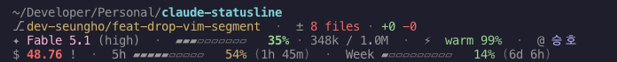
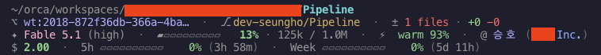

**English** | [한국어](README.ko.md)

# claude-code-statusline

> **Just glance.**  
> Your [Claude Code](https://www.anthropic.com/claude-code) limits, context, and active account — always in the same spot, no need to ask.

Instead of pausing work for `/usage`, `/context`, or `claude auth status`, just look.

## Preview

**Personal account**



**Team account (with warnings)**



## At a glance

- **`5h` limit**: usage bar, %, and time until reset. Highlights with `!` when under 15 minutes.
- **`Week` limit**: usage bar, %, and time until reset (shown in days/hours).
- **`✦` context**: model name (with the reasoning effort level in parentheses when the model reports one), bar, %, token count (input tokens incl. cache, matching Claude Code's own `used_percentage`). Color shifts at 50% and 80%, `!` above 90%. Abbreviates to `1.2M` past 1M tokens.
- **`⚡` cache**: prompt-cache state (`warm` / `cold`) and hit ratio, once Claude Code reports it.
- **`@` account**: `@ Name` for personal, `@ Name (OrgName)` for team — so you never lose track when switching between accounts.
- **`$` cost**: cumulative for the session. Color shifts at $2 and $5, highlighted with `!` when exceeded.
- **`Spend` limit**: usage bar, %, dollars spent / limit and time until reset. Shown only for seats behind a spend limit (Claude Code 2.1.251+; dollar figures 2.1.284+).
- **cwd, `⎇` git**: working directory, branch with dirty state (plus `⌥` worktree when applicable, names over 24 chars shortened with `…`, and an open PR badge like `#12 approved`, `!12` for GitLab MRs). Vim mode is left to Claude Code's own `-- INSERT --` indicator.

## Install

Requires Node ≥18 on PATH: `brew install node` (macOS), `winget install OpenJS.NodeJS.LTS` (Windows),
or a package from [nodejs.org](https://nodejs.org). The installer stops with a clear error if it is missing or too old.

`statusline.js` (Node ≥18) is the canonical runtime — cross-platform, zero npm
dependencies. The legacy `statusline.sh` is kept as a reference implementation
and will be phased out in a future release.

The installer creates timestamped backups (`*.bak.<YYYYMMDD-HHMMSS>`) of any
pre-existing `~/.claude/statusline.{sh,js}` and `~/.claude/settings.json`
before touching them — printed paths on completion.

### macOS / Linux / WSL2

```sh
curl -fsSL https://raw.githubusercontent.com/seungho-jeong/claude-code-statusline/main/install.sh | sh
```

### Windows (PowerShell 5.1+)

```powershell
iwr -useb https://raw.githubusercontent.com/seungho-jeong/claude-code-statusline/main/install.ps1 | iex
```

### Manual install

Place `statusline.js` at `~/.claude/statusline.js` (or
`%USERPROFILE%\.claude\statusline.js` on Windows) and add to
`~/.claude/settings.json`:

```json
{
  "statusLine": {
    "type": "command",
    "command": "node ~/.claude/statusline.js",
    "padding": 0,
    "refreshInterval": 30
  }
}
```

`refreshInterval` re-runs the script every 30 seconds so the `5h` countdown
keeps ticking between messages.

On Windows, the command becomes `node %USERPROFILE%\\.claude\\statusline.js`.
Windows Terminal + Git for Windows on Windows 10 1809+ is the supported
combination (ConPTY required for ANSI colors). Legacy `cmd.exe` runs without
crashing but ignores SGR escapes, so the output appears uncolored.

### Reference / legacy: shell runner

The original `statusline.sh` (bash + jq + coreutils) still ships in this repo
for byte-by-byte regression comparison against the Node port. It is supported
on macOS and Linux only and prints a deprecation warning on install:

```sh
curl -fsSL https://raw.githubusercontent.com/seungho-jeong/claude-code-statusline/main/install.sh | sh -s -- --runner sh
```

### Migration (sh → js)

The shell runner stays in the repo for now and is kept byte-identical to the
Node runner by the snapshot tests, but new features land in both only as long
as that remains cheap. No removal date is set. To switch an existing install:

```sh
curl -fsSL https://raw.githubusercontent.com/seungho-jeong/claude-code-statusline/main/install.sh | sh
```

The installer backs up `~/.claude/statusline.sh` and rewrites `statusLine.command`
to the Node runner. The old script is not deleted.

## Configuration

Every threshold can be overridden via `CCSL_*` environment variables.

| Variable | Default | Meaning |
|---|---|---|
| `CCSL_BAR_WIDTH` | `10` (`5` when `COLUMNS` < 100) | Bar cell count. Auto-shrinks on narrow terminals unless set explicitly |
| `CCSL_CTX_WARN` | `50` | Context % yellow threshold |
| `CCSL_CTX_CRIT` | `80` | Context % red threshold |
| `CCSL_FIRE_THRESHOLD` | `90` | Context `!` threshold |
| `CCSL_LIMIT_WARN_MIN` | `15` | 5h reset `!` threshold (minutes) |
| `CCSL_COST_WARN` | `2.0` | Cost yellow threshold ($) |
| `CCSL_COST_CRIT` | `5.0` | Cost red threshold ($) |
| `CCSL_GIT_TIMEOUT` | `1` | Git call upper bound (seconds) |

Example: `CCSL_CTX_WARN=30 claude`

## How it works

- **Account identity** is read directly from `oauthAccount` in `~/.claude.json`. No CLI call, so it stays stable across parallel sessions. Personal vs. team is decided from `organizationType` and `seatTier` when the file has them (Claude Code 2.1.x), falling back to the auto-generated organization-name pattern on older files.
- **Lightweight by design.** The Node runner uses `JSON.parse` and only forks `git`. The shell runner extracts every field with a single `jq` call using Unit Separator framing. Both share a per-CWD git cache file with a 5-second TTL, so the 30-second refresh costs one `git` fork per tick.
- **Forgiving of missing data.** If `rate_limits`, `~/.claude.json`, or `jq` is absent, only that element is omitted — everything else still renders.

## Tests

```sh
./tests/run.sh                          # Snapshot diff (plain) for sh + js
./tests/run.sh --mode ansi              # Compare ANSI-preserved snapshots
./tests/run.sh --runner js              # Run js only
./tests/run.sh --update                 # Regenerate plain snapshots (from sh)
./tests/perf.sh                         # Cold-start gate: <80ms average
./tests/integration-no-git.sh           # Fallback when git is absent
./tests/integration-no-home.sh          # Fallback when HOME is unset / missing
./tests/integration-install-backup.sh   # install.sh backs up pre-existing assets
./tests/integration-install-settings.sh # install.sh writes the statusLine entry (fresh + merge)
./tests/integration-worktree.sh         # ⌥ worktree name truncation, sh == js
./tests/integration-pr-badge.sh         # PR / MR badge on Line 2, sh == js
./tests/integration-narrow.sh           # bar width follows COLUMNS unless CCSL_BAR_WIDTH is set
./tests/integration-tenancy.sh          # @ personal/team from organizationType + seatTier, sh == js
```

Tests run inside an isolated temp directory so your host's git / HOME / cache
state never leaks in.

## Dependencies

- **statusline.js (canonical)**: Node ≥18. Zero npm dependencies. `git` is optional — without it, line 2 falls back to `(no git repo)`.
- **statusline.sh (legacy)**: `jq`, `git`, plus macOS/Linux coreutils.
- **install.sh / install.ps1**: `curl` (or `Invoke-WebRequest` on Windows). `jq` optional — settings.json will simply not be auto-edited if absent.

## License

MIT. See [LICENSE](LICENSE).
